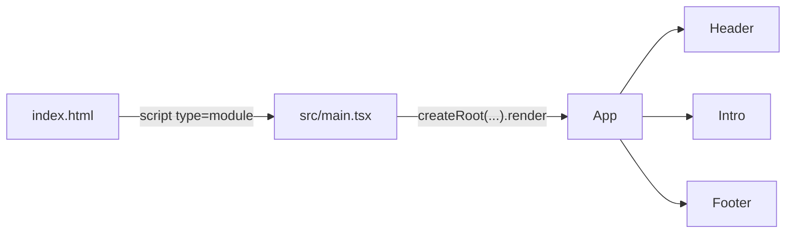

# Lab 1.1: Warum React? Projekt mit Vite starten

**Leitfragen:**

<details>
<summary>Was passiert zwischen dem Speichern einer Datei und der Anzeige im Browser?</summary>

Der Vite-Dev-Server erkennt die geänderte Datei, übersetzt nur dieses Modul und schickt es an den Browser. React rendert die betroffenen Komponenten neu, ohne die Seite komplett neu zu laden (Hot Reload).

</details>

<details>
<summary>Welche Datei ist der Einstiegspunkt der App?</summary>

`index.html` lädt per `<script type="module">` die Datei `src/main.tsx`. Dort hängt `createRoot(...).render(...)` die oberste Komponente in das Element `<div id="root">`.

</details>

<details>
<summary>Warum besteht eine React-App aus vielen kleinen Teilen statt aus einer großen HTML-Datei?</summary>

Jede Komponente kapselt Aussehen und Logik eines Bausteins. Bausteine lassen sich wiederverwenden, einzeln ändern und einzeln testen.

</details>

- Eine React-App ist ein Baum aus Komponenten, den der Browser als einzelne Seite (Single-Page-App) anzeigt.
- Vite liefert Dev-Server, Hot Reload und Build; Create React App ist seit 2025 eingestellt.

## Single-Page-App und Komponenten

Eine klassische Website lädt für jede Seite ein neues HTML-Dokument vom Server. Eine Single-Page-App (SPA) lädt einmal ein HTML-Gerüst und baut die Oberfläche danach im Browser mit JavaScript auf.

| Merkmal | Klassische Website | Single-Page-App mit React |
| --- | --- | --- |
| Seitenwechsel | neues HTML-Dokument vom Server | JavaScript tauscht Teile der Oberfläche aus |
| Zustand (z. B. Eingaben) | geht beim Neuladen verloren | bleibt im Speicher der App |
| Aufbau | eine HTML-Datei pro Seite | Baum aus Komponenten |
| Wiederverwendung | Kopieren von HTML-Blöcken | Komponente mehrfach einsetzen |

Eine Komponente ist eine Funktion, die beschreibt, was auf dem Bildschirm stehen soll. Der Name beginnt mit einem Großbuchstaben, der Rückgabewert ist JSX (siehe Lab 1.3).

```tsx
// src/examples/m01-react-start/l01-why-react-and-vite-setup/index.tsx (Auszug)
const Header = () => <h1>Willkommen bei React</h1>;
const Intro = () => <p>Diese Seite besteht aus drei kleinen Komponenten.</p>;

const App = () => (
  <main>
    <Header />
    <Intro />
  </main>
);
```

## Vite als Werkzeug

Browser verstehen weder TypeScript noch JSX. Vite übersetzt beides, startet einen Entwicklungsserver und erzeugt am Ende den fertigen Build.

| Befehl | Wirkung |
| --- | --- |
| `npm install` | lädt alle Pakete aus `package.json` nach `node_modules/` |
| `npm run dev` | startet den Dev-Server mit Hot Reload (Standard: `http://localhost:5173`) |
| `npm run build` | prüft Typen mit `tsc -b` und erzeugt den optimierten Build in `dist/` |
| `npm run preview` | zeigt den Build aus `dist/` lokal an |

Hot Reload bedeutet: Nach dem Speichern erscheint die Änderung sofort im Browser. In vielen Fällen bleibt dabei der State der Komponenten erhalten.

> **Merksatz:** Seit 2025 gilt Vite (oder ein Framework) als Startweg für React; Tutorials mit `create-react-app` sind veraltet.

## Einordnung: Vite oder Framework

Create React App (CRA) wurde 2025 eingestellt und taucht nur noch in alten Tutorials auf. Die React-Dokumentation empfiehlt für neue Produktiv-Apps ein Framework (siehe [react.dev: Creating a React App](https://react.dev/learn/creating-a-react-app)).

| Weg | Typischer Einsatz | Im Kurs |
| --- | --- | --- |
| Vite mit Template `react-ts` | Lernen, Prototypen, reine Browser-Apps | ja, Grundlage des Kurs-Repos |
| Framework (Next.js, React Router im Framework-Modus) | große Produktiv-Apps mit Server-Funktionen | nur als Ausblick |
| Create React App | nur noch in Altprojekten | nein, eingestellt |

## Aufbau des Vite-Projekts

Die Kette von der HTML-Datei bis zur sichtbaren Komponente ist in jedem Vite-Projekt gleich.



`index.html` enthält nur ein leeres Wurzelelement und die Einbindung des Skripts:

```html
<body>
  <div id="root"></div>
  <script type="module" src="/src/main.tsx"></script>
</body>
```

`src/main.tsx` aus dem Vite-Template `react-ts` (im Kurs-Repo steht an Stelle von `App` der `Launcher`):

```tsx
import { StrictMode } from "react";
import { createRoot } from "react-dom/client";
import "./index.css";
import App from "./App.tsx";

createRoot(document.getElementById("root")!).render(
  <StrictMode>
    <App />
  </StrictMode>,
);
```

`<StrictMode>` ist im Template standardmäßig an. Es führt in der Entwicklung zusätzliche Prüfungen aus, etwa doppeltes Rendern (siehe Lab 2.1).

## Rundgang durch das Kurs-Repo

Das Kurs-Repo enthält Handouts und lauffähigen Code. Gearbeitet wird in `project/`.

| Pfad | Inhalt |
| --- | --- |
| `m00-overview/` | Überblick, Themen, Glossar, FAQ |
| `mNN-<modul>/lNN-<lab>/` | Handouts je Lab: `-thx.md` (Theorie), `-exc.md` (Übung), `-sol.md` (Lösung) |
| `mNN-<modul>/*-cheatsheet.md` | Schnellreferenz je Modul |
| `project/src/examples/` | fertige Beispiel-App je Lab (`index.tsx`, ggf. `app-<name>.tsx`) |
| `project/src/playground/App.tsx` | Arbeitsdatei für alle Übungen |
| `project/src/starters/` | Starter-Dateien, die nach `src/playground/App.tsx` kopiert werden |
| `project/src/shared/` | gemeinsamer Code (z. B. `character.ts` mit `API_BASE_URL`) |
| `project/src/launcher/` | Startseite und Umschalter (nicht ändern) |
| `project/public/characters-page-1.json` | Offline-Kopie der API-Daten (Fallback) |

Der Launcher zeigt im Browser:

| Adresse | Anzeige |
| --- | --- |
| `/` | Übersicht aller Beispiel-Apps |
| `/examples/<modul>/<lab>` | fertige Beispiel-App eines Labs |
| `/playground` | eigener Code aus `src/playground/App.tsx` |

## Neues Projekt mit `npm create vite@latest`

Ein leeres Projekt entsteht in drei Schritten. Das Template `react-ts` bringt React, TypeScript und `oxlint` als Linter mit.

```bash
npm create vite@latest hello-react -- --template react-ts
cd hello-react
npm install
npm run dev
```

Das Kurs-Repo nutzt statt `oxlint` ESLint mit den React-Hooks-Regeln (`npm run lint`).

## Fazit

- Eine React-App besteht aus Komponenten, die `App` zu einer Seite zusammensetzt.
- `index.html` → `src/main.tsx` → `App` ist die Kette vom Browser bis zur Komponente.
- `npm run dev` startet Vite mit Hot Reload; Create React App ist veraltet.
- Im Kurs-Repo zeigen `src/examples/` die Lösungen, `src/playground/App.tsx` ist der Arbeitsplatz.

Die Übung bringt das Kurs-Repo zum Laufen und ändert die erste Überschrift im Playground.
