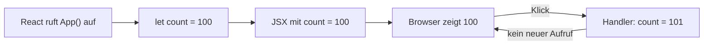

# Lab 2.1: Counter ohne State – Warum ändert sich nichts?

**Leitfragen:**

<details>
<summary>Die Variable ändert sich, die Anzeige nicht – woran liegt das?</summary>

Der Klick ändert nur die lokale Variable `count`. React zeichnet die Komponente nur neu, wenn die Komponentenfunktion erneut aufgerufen wird, und das löst eine Variablenänderung nicht aus.

</details>

<details>
<summary>Wie oft wird „RENDERING“ geloggt?</summary>

Einmal beim Laden der Seite (in der Entwicklung zweimal wegen StrictMode) und bei Klicks gar nicht. Es findet kein neues Rendern statt.

</details>

<details>
<summary>Was bedeutet „State“?</summary>

State sind Daten einer Komponente, die React zwischen Renders speichert. Eine Änderung per Setter löst ein neues Rendern aus (siehe Lab 2.2).

</details>

- Ein Event-Handler läuft beim Klick, ändert aber nichts an der Anzeige, solange kein neues Rendern ausgelöst wird.
- Eine Komponente ist eine Funktion; jeder Aufruf startet mit frischen lokalen Variablen.

## Event-Handler mit onClick

Ein Event-Handler ist eine Funktion, die bei einem Ereignis (Klick, Eingabe, Tastendruck) läuft. React erwartet die Funktion selbst, nicht ihr Ergebnis.

| Schreibweise | Wirkung |
| --- | --- |
| `onClick={handleCountUp}` | React ruft `handleCountUp` beim Klick auf |
| `onClick={handleCountUp()}` | Fehler: Aufruf beim Rendern, `undefined` wird als Handler übergeben |
| `onClick={() => handleAdd(5)}` | Arrow Function ruft beim Klick mit Argument auf |

| Ereignis | Prop | Typischer Einsatz |
| --- | --- | --- |
| Klick | `onClick` | Buttons, Einträge |
| Eingabe geändert | `onChange` | Textfelder (Lab 2.3) |
| Taste gedrückt | `onKeyDown` | Enter erkennen (Lab 2.4) |
| Formular abgeschickt | `onSubmit` | Formulare; `e.preventDefault()` verhindert das Neuladen der Seite |

Namenskonvention: Funktionen, die ein Ereignis behandeln, heißen `handleXyz` (`handleCountUp`, `handleKeyDown`). Props, die eine Komponente für Rückrufe anbietet, heißen `onXyz` (`onClick`, später `onRemove`).

## Counter ohne State

Die Variable `count` wird im Handler erhöht und geloggt. Die Anzeige liest dieselbe Variable.

```tsx
const App = () => {
  console.warn("RENDERING");
  let count = 100;

  const handleCountUp = () => {
    count += 1;
    console.warn("UP", count);
  };

  const handleCountDown = () => {
    count -= 1;
    console.warn("DOWN", count);
  };

  return (
    <main>
      <h1>Counter App</h1>
      <div>{count}</div>
      <button onClick={handleCountUp}>+</button>
      <button onClick={handleCountDown}>–</button>
    </main>
  );
};
```

Die vollständige App steht in `src/examples/m02-state-and-events/l01-counter-without-state/index.tsx`.

| Zeitpunkt | Konsole | Anzeige |
| --- | --- | --- |
| Seite geladen | `RENDERING` (in der Entwicklung doppelt) | `100` |
| Klick auf „+“ | `UP 101` | `100` |
| Zweiter Klick auf „+“ | `UP 102` | `100` |
| Klick auf „–“ | `DOWN 101` | `100` |

Die Variable zählt in der Konsole korrekt weiter, weil beide Handler dieselbe Variable des einen Renders ändern. Die Anzeige liest `count` nur beim Rendern und wird nie aktualisiert.

## Rendern als Funktionsaufruf

React ruft die Komponentenfunktion auf und zeigt deren Rückgabewert an. Jeder Aufruf legt seine lokalen Variablen neu an.



Mit den React Developer Tools lässt sich der Effekt verfolgen: Im Tab „Components“ erscheint `App` ohne State-Eintrag, weil die Komponente keinen State besitzt.

StrictMode ist im Kurs-Repo aktiv (`src/main.tsx`) und ruft Komponentenfunktionen in der Entwicklung doppelt auf, um unreine Komponenten aufzuspüren. Deshalb erscheint `RENDERING` beim Laden zweimal; mit installierten React Developer Tools ist der zweite Eintrag abgedunkelt. Im Build läuft der Aufruf nur einmal.

## Der Linter meldet das Problem

Der Linter des Projekts (`npm run lint`) kennt dieses Muster. Ohne den Kommentar `eslint-disable` am Dateianfang meldet er:

```text
react-hooks/immutability
Error: Cannot reassign variable after render completes
```

Die Meldung ist ein Hinweis auf das Lab-Thema: Werte, die sich nach dem Rendern ändern und angezeigt werden sollen, gehören in State.

> **Merksatz:** Eine normale Variable überlebt kein Rendern, und ihre Änderung löst keines aus.

## Fazit

- `onClick` bekommt eine Funktion; Handler heißen `handleXyz`, Callback-Props `onXyz`.
- Der Handler ändert `count`, aber React rendert nicht neu, deshalb bleibt die Anzeige bei 100.
- „RENDERING“ erscheint nur beim Laden (in der Entwicklung doppelt), nicht bei Klicks.

Die Übung lässt die App laufen, vergleicht Konsole und Anzeige und hält die Erklärung in einem Satz fest.
