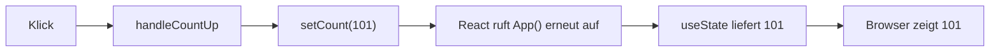

# Lab 2.2: useState – Der Counter wird lebendig

**Leitfragen:**

<details>
<summary>Warum zeigt das Log nach dem Klick noch den alten Wert?</summary>

`count` ist ein Schnappschuss des aktuellen Renders. Der Setter plant ein neues Rendern ein; der laufende Handler arbeitet weiter mit dem alten Wert. Erst der nächste Render liefert den neuen.

</details>

<details>
<summary>Was passiert bei <code>count = count + 1</code> statt <code>setCount</code>?</summary>

`count` ist eine Konstante (`const [count, setCount] = …`), die Zuweisung wirft einen `TypeError`. Selbst mit `let` bliebe die Anzeige stehen, weil kein Rendern ausgelöst wird.

</details>

<details>
<summary>Wie viele States braucht der Counter mit Schrittweite?</summary>

Zwei: einen für den Zählerstand und einen für die Schrittweite. Beide sind unabhängige Werte, die sich getrennt ändern.

</details>

- `useState` liefert den aktuellen Wert und einen Setter; der Setter löst ein neues Rendern aus.
- State ist pro Render ein Schnappschuss und gilt nur für diese Komponente (lokaler State).

## Erst ohne, dann mit State

Die App aus Lab 2.1 wird mit drei Änderungen lebendig: Import, `useState` statt `let`, Setter in den Handlern.

```tsx
import { useState } from "react";

const App = () => {
  console.warn("RENDERING");
  const [count, setCount] = useState(100); // vorher: let count = 100;

  const handleCountUp = () => {
    setCount(count + 1);                   // vorher: count += 1;
    console.warn("UP", count);             // zeigt noch den ALTEN Wert
  };

  const handleCountDown = () => {
    if (count > 0) {                       // Untergrenze 0
      setCount(count - 1);
    }
    console.warn("DOWN", count);
  };

  const handleReset = () => {
    setCount(100);
  };

  return (
    <main>
      <h1>Counter App</h1>
      <div>{count}</div>
      <button onClick={handleCountUp}>+</button>
      <button onClick={handleCountDown}>–</button>
      <button onClick={handleReset}>Reset</button>
    </main>
  );
};
```

Die vollständige App steht in `src/examples/m02-state-and-events/l02-usestate-counter/index.tsx`.

| Teil | Bedeutung |
| --- | --- |
| `useState(100)` | Hook; `100` ist der Startwert, er gilt nur beim ersten Rendern |
| `count` | aktueller Wert in diesem Render (nur lesen) |
| `setCount` | Setter; speichert den neuen Wert und plant ein neues Rendern |
| `const [a, b] = …` | Array-Destructuring (Lab 1.2); die Namen wählt der Code |



## State ist ein Schnappschuss pro Render

Jeder Render hat seinen eigenen, unveränderlichen Wert für `count`. Das Log im Handler zeigt deshalb den Wert des Renders, in dem der Klick stattfand.

| Aktion | Konsole | Anzeige |
| --- | --- | --- |
| Seite geladen | `RENDERING` (in der Entwicklung doppelt) | `100` |
| Klick auf „+“ | `UP 100`, danach `RENDERING` | `101` |
| Klick auf „+“ | `UP 101`, danach `RENDERING` | `102` |

Typen für State ergeben sich meist aus dem Startwert. Bei leeren Startwerten gibt `<…>` den Typ an.

| Aufruf | Typ des States |
| --- | --- |
| `useState(100)` | `number` |
| `useState("")` | `string` |
| `useState(false)` | `boolean` |
| `useState<string[]>([])` | Array aus Texten |
| `useState<Character \| null>(null)` | `Character` oder noch nichts |

## Regeln der Hooks

Hooks sind Funktionen, die mit `use` beginnen (`useState`, später `useEffect`, `useRef`). React merkt sich State anhand der Reihenfolge der Aufrufe.

| Regel | Beispiel für einen Verstoß |
| --- | --- |
| Nur oben in der Komponente aufrufen | Aufruf nach einem frühen `return` |
| Nie in Bedingungen, Schleifen oder verschachtelten Funktionen | `if (x) { useState(0); }` |
| Immer in gleicher Reihenfolge aufrufen | Aufruf nur bei manchen Renders |
| Nur in Funktionskomponenten und eigenen Hooks | Aufruf in einer normalen Funktion |

```tsx
const App = (props: { visible: boolean }) => {
  // Falsch: Reihenfolge ändert sich, wenn visible wechselt
  // if (props.visible) { const [count, setCount] = useState(0); }

  const [count, setCount] = useState(0); // richtig: immer, an oberster Stelle
  return <div>{count}</div>;
};
```

Der Linter prüft die Regeln (`react-hooks/rules-of-hooks`). Die vollständige Liste der Hooks folgt in Lab 8.3.

## State in den React Developer Tools beobachten

Im Tab „Components“ der React Developer Tools zeigt die gewählte Komponente `App` unter „hooks“ den State.

| Schritt | Wirkung |
| --- | --- |
| Komponente `App` im Baum wählen | rechts erscheinen „hooks“ mit `State: 100` |
| Wert im State-Eintrag ändern und Enter drücken | Komponente rendert mit dem neuen Wert, die Zahl auf der Seite ändert sich |
| Klick auf „+“ | der State-Eintrag zeigt den neuen Wert |

## Randnotiz: Klassenkomponenten in Altprojekten

Vor den Hooks (React 16.8, 2019) hatte nur die Klassenkomponente State (`this.state`, `this.setState`). Funktionskomponenten gelten heute als Standard; Klassen laufen weiter und stehen in Altprojekten.

```tsx
// src/examples/m02-state-and-events/l02-usestate-counter/app-class.tsx (Auszug)
class App extends Component<object, State> {
  state: State = { count: 100 };

  handleCountUp = () => {
    this.setState({ count: this.state.count + 1 });
  };

  render() {
    return <div>{this.state.count}</div>;
  }
}
```

| Aspekt | Funktionskomponente (Hooks) | Klassenkomponente |
| --- | --- | --- |
| State | `useState` | `this.state`, `this.setState` |
| Aufbau | eine Funktion | Klasse mit `render()` |
| Heute | Standard im Kurs und in neuen Projekten | nur in Altprojekten |

Frühere Folien nennen Funktionskomponenten „stateless“; seit Hooks stimmt das nicht mehr.

## Fazit

- `useState` ersetzt die normale Variable: Wert lesen, über den Setter ändern, React rendert neu.
- Der Wert im Handler ist der Schnappschuss des aktuellen Renders; das Log zeigt ihn deshalb vor dem Update.
- Hooks stehen immer oben in der Komponente, nie in Bedingungen oder Schleifen.
- Die React Developer Tools zeigen und ändern State zur Laufzeit.

Die Übung stellt den Counter aus Lab 2.1 auf `useState` um und ergänzt Reset und Untergrenze.
