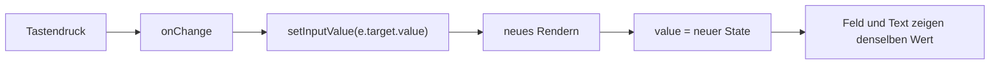

# Lab 2.3: Eingaben verarbeiten – Controlled Inputs

**Leitfragen:**

<details>
<summary>Was passiert, wenn <code>value</code> gesetzt ist, aber <code>onChange</code> fehlt?</summary>

Das Feld ist schreibgeschützt: Tippen ändert nichts, weil der State sich nicht ändert. React warnt in der Konsole vor einem Feld mit `value` ohne `onChange`.

</details>

<details>
<summary>Wie leert man ein Feld, ohne das DOM anzufassen?</summary>

Durch Setzen des States auf einen leeren Text (`setInputValue("")`). Das Feld zeigt immer den State an, also wird es beim nächsten Rendern leer.

</details>

- Ein Controlled Input zeigt immer den State an (`value`) und meldet jede Änderung an den State zurück (`onChange`).
- Der State ist die einzige Wahrheit; das Feld besitzt keinen eigenen Wert.

## Eingabe ohne und mit React

Ohne React liest JavaScript den Wert direkt aus dem DOM-Element und schreibt in andere Elemente.

```html
<input id="name" />
<p id="output"></p>
<script>
  const input = document.getElementById("name");
  input.addEventListener("input", () => {
    document.getElementById("output").textContent = input.value; // Wert liegt im DOM
  });
</script>
```

In React liegt der Wert im State, und die Oberfläche folgt dem State. Es gibt keinen direkten Zugriff auf das DOM.

| Aspekt | Vanilla JavaScript | React (Controlled Input) |
| --- | --- | --- |
| Wo liegt der Wert? | im DOM-Element (`input.value`) | im State (`inputValue`) |
| Änderung erkennen | `addEventListener("input", …)` | `onChange={…}` |
| Anzeige aktualisieren | von Hand (`textContent = …`) | automatisch durch neues Rendern |
| Feld leeren | `input.value = ""` | `setInputValue("")` |

## Controlled Input

```tsx
import { useState } from "react";

const App = () => {
  const [inputValue, setInputValue] = useState("");

  return (
    <main>
      <h1>Input App</h1>
      <input
        type="text"
        value={inputValue}                           // Feld zeigt den State
        onChange={(e) => setInputValue(e.target.value)} // jede Änderung geht zurück in den State
        placeholder="Hier etwas eingeben …"
      />
      <p>Eingegebener Text: {inputValue}</p>
      <button onClick={() => setInputValue("")}>Clear</button>
    </main>
  );
};
```

Die vollständige App steht in `src/examples/m02-state-and-events/l03-controlled-inputs/index.tsx`.



| Teil | Bedeutung |
| --- | --- |
| `value={inputValue}` | das Feld zeigt den State |
| `onChange` | läuft bei jeder Änderung des Felds |
| `e.target.value` | aktueller Text im Feld; immer ein `string`, auch bei `type="number"` |
| `e` | Event-Objekt; Typ bei Bedarf `ChangeEvent<HTMLInputElement>` |
| `setInputValue("")` | leert das Feld über den State |

Übliche Handler-Schreibweise für längere Logik:

```tsx
import type { ChangeEvent } from "react";

const handleChange = (e: ChangeEvent<HTMLInputElement>) => {
  setInputValue(e.target.value);
};
```

## Fehlerbild: value ohne onChange

Ohne `onChange` bleibt der State unverändert, und das Feld zeigt immer den Startwert.

```tsx
<input type="text" value={inputValue} />
```

Konsole:

```text
You provided a `value` prop to a form field without an `onChange` handler. This will render a read-only field. If the field should be mutable use `defaultValue`. Otherwise, set either `onChange` or `readOnly`.
```

Die Beispiel-App dazu: `src/examples/m02-state-and-events/l03-controlled-inputs/app-value-without-onchange.tsx`.

| Variante | Attribut | Wer verwaltet den Wert? |
| --- | --- | --- |
| Controlled | `value` + `onChange` | React-State |
| Uncontrolled | `defaultValue` (nur Startwert) | das DOM-Element |

Im Kurs gelten Controlled Inputs als Standard, weil der State jederzeit alle Werte kennt.

## Eingaben prüfen

Prüfungen und Hinweise lassen sich aus dem State ableiten. Es braucht keinen zweiten State.

```tsx
const MAX_LENGTH = 10;
const [inputValue, setInputValue] = useState("");
const isTooLong = inputValue.length > MAX_LENGTH; // wird bei jedem Rendern neu berechnet

// im JSX
{isTooLong && <p>Maximal {MAX_LENGTH} Zeichen erlaubt.</p>}
```

| Ansatz | Umsetzung | Wirkung |
| --- | --- | --- |
| Hinweis anzeigen | Wert aus dem State ableiten (`isTooLong`) | Eingabe bleibt, Meldung erscheint |
| Eingabe ablehnen | im Handler `if (…) setInputValue(…)` | zu lange Texte erreichen den State nie |

Die lauffähige Variante mit Rahmenfarbe und Zeichenzähler steht in `src/examples/m02-state-and-events/l03-controlled-inputs/app-validation.tsx`.

## Fazit

- `value` + `onChange` machen ein Feld zum Controlled Input; der State ist die einzige Wahrheit.
- Das Feld leeren heißt den State leeren; das DOM wird nie direkt angefasst.
- `value` ohne `onChange` erzeugt ein schreibgeschütztes Feld und eine Warnung.
- Prüfmeldungen entstehen aus dem State und brauchen keinen eigenen State.

Die Übung baut die „Input App“ mit Live-Anzeige und Clear-Button.
