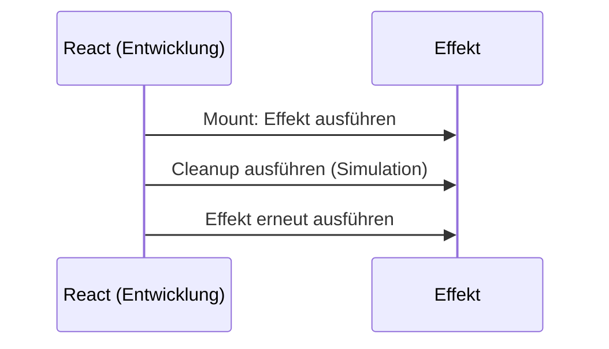

# Lab 3.1: useEffect – Code beim Start und bei Änderungen

**Leitfragen:**

<details>
<summary>Wie begrüßt eine App einmal beim Start mit „Willkommen“?</summary>

Mit einem Effekt und leerem Dependency-Array: `useEffect(() => { console.log("Willkommen"); }, [])`. Er läuft einmal nach dem ersten Render.

</details>

<details>
<summary>Warum feuert Effekt 2 nicht, wenn Counter 2 sich ändert?</summary>

Das Dependency-Array von Effekt 2 enthält nur `count1`. React führt den Effekt nur aus, wenn sich ein Wert aus dem Array geändert hat.

</details>

<details>
<summary>Warum erscheint „Willkommen“ in der Entwicklung zweimal?</summary>

`<StrictMode>` führt Effekte in der Entwicklung absichtlich zweimal aus (Mount → Cleanup → Mount), um fehlende Cleanups aufzudecken. Im Produktions-Build läuft der Effekt einmal.

</details>

<details>
<summary>Wann ist ein Effekt überflüssig?</summary>

Wenn sich der Wert aus State oder Props berechnen lässt oder wenn ein Klick die Ursache ist. Dann genügt eine Berechnung im Render bzw. ein Event-Handler.

</details>

- Ein Effekt synchronisiert eine Komponente mit etwas außerhalb von React (Log, Timer, API, Abo, DOM).
- Das Dependency-Array bestimmt, wann der Effekt läuft: nie neu (`[]`), bei Änderung (`[count]`) oder nach jedem Render (ohne Array).

## Effekt und Dependency-Array

Ein Effekt läuft **nach** dem Render, nachdem React die Änderung auf dem Bildschirm eingefügt hat. Seiteneffekte gehören nicht in den Render selbst, weil dieser bei jedem Re-Render erneut läuft.

```tsx
useEffect(() => {
  // Code, der nach dem Render laufen soll
}, [/* Abhängigkeiten */]);
```

| Dependency-Array | Wann läuft der Effekt? | Typischer Einsatz |
| ---------------- | ---------------------- | ----------------- |
| `[]` | einmal nach dem ersten Render | Begrüßung, einmaliger Abruf, Timer starten |
| `[count]` | nach dem ersten Render und bei jeder Änderung von `count` | auf einen Wert reagieren |
| ohne Array | nach jedem Render | selten nötig, meist ein Hinweis auf fehlende Abhängigkeiten |

Alle Werte aus State oder Props, die im Effekt gelesen werden, gehören ins Array. Die Regel `react-hooks/exhaustive-deps` des Linters meldet fehlende Einträge.

Typische Einsatzgebiete von Effekten:

- Daten laden (ab Lab 5.1)
- Abonnements und Timer einrichten und wieder aufräumen (Lab 3.2)
- DOM außerhalb von React ändern (z. B. Fokus, Fremdbibliotheken)

## Beispiel: drei Effekte im Counter

Der Effekt-Labor-Counter hat zwei States und drei Effekte mit unterschiedlichem Array (`src/examples/m03-effects-and-refs/l01-useeffect-basics/index.tsx`):

```tsx
const [count1, setCount1] = useState(0);
const [count2, setCount2] = useState(0);

// Effekt 1: leeres Array, läuft einmal nach dem ersten Render
useEffect(() => {
  console.log("Effekt 1: Willkommen!");
}, []);

// Effekt 2: läuft nach dem ersten Render und bei jeder Änderung von count1
useEffect(() => {
  console.log("Effekt 2: count1 ist jetzt", count1);
}, [count1]);

// Effekt 3: ohne Array, läuft nach jedem Render
useEffect(() => {
  console.log("Effekt 3: irgendetwas hat sich geändert");
});
```

Erwartete Konsole im Browser nach dem ersten Laden und nach je einem Klick:

| Aktion | Effekt 1 | Effekt 2 | Effekt 3 |
| ------ | -------- | -------- | -------- |
| Seite laden (Produktion) | 1× | 1× | 1× |
| Seite laden (Entwicklung, StrictMode) | 2× | 2× | 2× |
| Klick auf „+ Counter 1“ | – | 1× | 1× |
| Klick auf „+ Counter 2“ | – | – | 1× |

## StrictMode: Effekte laufen in der Entwicklung doppelt

Das Vite-Template rendert die App in `<StrictMode>` (`src/main.tsx`). In der Entwicklung simuliert React damit, dass eine Komponente verschwindet und wiederkommt.



- Der Doppelaufruf gibt es nur in der Entwicklung, nicht im Produktions-Build.
- Ein Effekt, der durch den zweiten Lauf kaputtgeht, hat meist einen fehlenden Cleanup (Lab 3.2).
- Dasselbe gilt für das Rendern: Die Komponente läuft in der Entwicklung doppelt, ein `console.log` im Render kann deshalb doppelt erscheinen.

> **Merksatz:** Ein Effekt ist für Verbindungen zur Außenwelt da. Was sich aus State berechnen lässt, wird berechnet.

## Nicht alles braucht einen Effekt

Ein typischer Anfängerfehler: Ein Wert wird aus State berechnet und per Effekt in einen zweiten State kopiert.

```tsx
// Umständlich: zusätzlicher State, zusätzlicher Effekt, ein Render mehr
const [parity, setParity] = useState("gerade");
useEffect(() => {
  setParity(count1 % 2 === 0 ? "gerade" : "ungerade");
}, [count1]);

// Besser: direkt im Render berechnen
const parity = count1 % 2 === 0 ? "gerade" : "ungerade";
```

Der Linter (`react-hooks/set-state-in-effect`) meldet ein synchrones `setState` im Effekt-Körper.

| Situation | Richtiger Ort |
| --------- | ------------- |
| Wert lässt sich aus State/Props berechnen (gerade/ungerade, Summe, gefilterte Liste) | direkt im Render als Variable |
| Reaktion auf einen Klick oder eine Eingabe | Event-Handler |
| Seitentitel setzen | `<title>` im JSX |
| Timer, Abo, Netzwerk, Fokus – Verbindung zur Außenwelt | Effekt |

## Seitentitel in React 19: `<title>` statt Effekt

Seit React 19 darf `<title>` (und `<meta>`) in jeder Komponente stehen. React setzt das Element automatisch in den `<head>` des Dokuments.

```tsx
// ohne Effekt: der Titel folgt dem State automatisch
return (
  <div>
    <title>{`Counter: ${count1}`}</title>
    {/* … */}
  </div>
);
```

Die ältere Variante mit Effekt steht in `app-title-with-effect.tsx` und ist in vielen bestehenden Projekten zu finden:

```tsx
useEffect(() => {
  document.title = `Counter: ${count}`;
}, [count]);
```

Beide Varianten sind lauffähig im Launcher unter `/examples/m03-effects-and-refs/l01-useeffect-basics` und `/examples/m03-effects-and-refs/l01-useeffect-basics/app-title-with-effect`.

> In älteren Klassenkomponenten übernahmen `componentDidMount` und `componentDidUpdate` diese Aufgabe. Ein Effekt beschreibt dagegen, womit die Komponente synchron gehalten wird, nicht in welcher Lebensphase Code läuft.

## Fazit

- `[]` = einmal, `[wert]` = bei Änderung, ohne Array = nach jedem Render.
- StrictMode ruft Effekte in der Entwicklung doppelt auf, damit fehlende Cleanups auffallen.
- Berechenbares wird berechnet, nicht per Effekt synchronisiert; den Titel liefert `<title>`.

In der Übung entsteht das Effekt-Labor mit zwei Countern, drei Effekten und dem Seitentitel in zwei Varianten.
