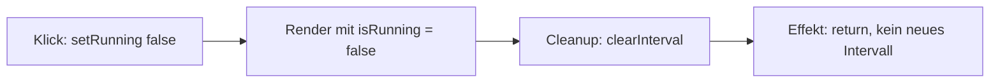

# Lab 3.2: Live-Uhr – Intervalle und Cleanup

**Leitfragen:**

<details>
<summary>Wer räumt den Timer auf, wenn die Komponente verschwindet?</summary>

Nur die Cleanup-Funktion des Effekts. Ohne sie läuft das Intervall im Browser weiter, auch wenn die Komponente nicht mehr angezeigt wird.

</details>

<details>
<summary>Warum tickt die Uhr nach mehrfachem Speichern plötzlich zu schnell?</summary>

Bei jedem Hot Reload läuft der Effekt erneut. Ohne Cleanup bleibt das alte Intervall bestehen, und die Intervalle summieren sich.

</details>

<details>
<summary>Woran erkennt React, dass ein Timer neu gestartet werden muss?</summary>

An einer Änderung im Dependency-Array, z. B. `[isRunning]`. React führt dann zuerst den Cleanup des alten Effekts aus und danach den Effekt mit dem neuen Wert.

</details>

- Ein Intervall im Effekt braucht immer eine Cleanup-Funktion, die es wieder löscht.
- Start und Stopp lassen sich über State im Dependency-Array steuern.

## Intervall im Effekt

`setInterval(fn, ms)` ruft `fn` wiederholt auf und liefert eine ID. `clearInterval(id)` beendet das Intervall. Im Browser ist die ID eine Zahl, deshalb `window.setInterval` und der Typ `number` (nicht `NodeJS.Timeout`).

Der Zustand der Uhr ist ein State, das Intervall startet im Effekt (Stufe a, `app-a-running.tsx`):

```tsx
const [now, setNow] = useState(() => new Date());

useEffect(() => {
  const timerId = window.setInterval(() => {
    setNow(new Date()); // jede Sekunde neuer State → Re-Render
  }, 1000);

  return () => window.clearInterval(timerId); // Cleanup
}, []);

// im JSX
<div>{now.toLocaleTimeString("de-DE")}</div>
```

## Fehlerfall: Intervall ohne Cleanup

`app-no-cleanup.tsx` startet das Intervall, räumt es aber nie auf:

```tsx
useEffect(() => {
  window.setInterval(() => {
    console.log("Tick");
    setNow(new Date());
    setTicks((prev) => prev + 1);
  }, 1000);
}, []); // kein return → kein Cleanup
```

| Beobachtung | Ursache |
| ----------- | ------- |
| „Ticks“ zählt in der Entwicklung doppelt so schnell (+2 pro Sekunde) | StrictMode führt den Effekt zweimal aus, zwei Intervalle laufen parallel |
| „Tick“ erscheint nach „Uhr ausblenden“ weiter in der Konsole | Das Intervall gehört dem Browser, nicht der Komponente |
| Uhr tickt nach mehrfachem Speichern schneller | Jeder Hot Reload startet ein weiteres Intervall |

StrictMode macht den Fehler sofort sichtbar. Im Produktions-Build läge er erst bei Navigation oder erneutem Einblenden vor.

## Cleanup-Funktion

Die Funktion, die der Effekt zurückgibt, räumt den **vorherigen** Effektlauf auf.

| Zeitpunkt | Cleanup läuft? |
| --------- | -------------- |
| Komponente verschwindet (Unmount) | ja |
| Ein Wert im Dependency-Array ändert sich | ja, vor dem nächsten Effektlauf |
| StrictMode simuliert Unmount/Mount (nur Entwicklung) | ja |
| Re-Render ohne Änderung im Array | nein |

Faustregel: Alles, was ein Effekt startet (Intervall, Timeout, Event-Listener, Abo), beendet der Cleanup.

## Stufen der Uhr

| Stufe | Datei | Idee | Grenze |
| ----- | ----- | ---- | ------ |
| a | `app-a-running.tsx` | Uhr läuft, Cleanup beim Verlassen | nicht stoppbar |
| b | `app-b-stop.tsx` | Klick stoppt, Timer-ID liegt in einem Ref (`useRef`, siehe Lab 3.3) | Effekt läuft nur einmal, Neustart nicht möglich |
| c | `index.tsx` | Start/Stopp über State `isRunning` im Dependency-Array | – |

Stufe c ist der Standardweg:

```tsx
const [now, setNow] = useState(() => new Date());
const [isRunning, setRunning] = useState(true);

useEffect(() => {
  if (!isRunning) return; // gestoppt: kein Intervall

  const timerId = window.setInterval(() => {
    console.log("Tick");
    setNow(new Date());
  }, 1000);

  return () => window.clearInterval(timerId);
}, [isRunning]);

// im JSX
<div onClick={() => setRunning(false)}>{now.toLocaleTimeString("de-DE")}</div>
<button onClick={() => setRunning(true)} disabled={isRunning}>Restart</button>
```

Ablauf bei einem Klick auf die Uhr:



Beim Klick auf „Restart“ ändert sich `isRunning` auf `true`: Der Effekt läuft erneut und startet ein neues Intervall. Der alte Cleanup hat das Intervall davor gelöscht, es laufen nie zwei parallel.

> In älterem Code steht oft `let timerId` im Effekt und `if (timerId) clearInterval(timerId)` im Cleanup. Das funktioniert ebenfalls; der Rückgabewert von `setInterval` als `const` ist kürzer und genügt.

> **Merksatz:** Was ein Effekt startet, beendet sein Cleanup.

## Fazit

- `setInterval` im Effekt starten, per `clearInterval` im Cleanup beenden.
- Ohne Cleanup laufen Intervalle doppelt (StrictMode) oder weiter, wenn die Komponente verschwindet.
- Eine Änderung im Dependency-Array (`[isRunning]`) startet Cleanup und Effekt neu – so steuert State Start und Stopp.

In der Übung entsteht die „time.is“-Uhr in den drei Stufen a, b und c.
