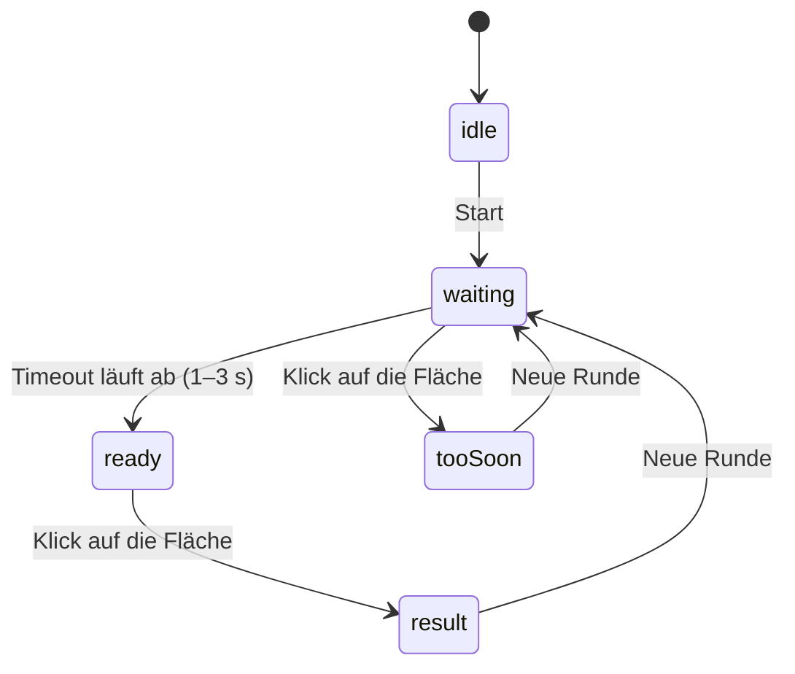

# Lab 4.3: Mini-Challenge – Reaktionsspiel

**Leitfragen:**

<details>
<summary>Welche Zustände hat das Spiel?</summary>

Fünf: `idle` (vor dem Start), `waiting` (rot, Wartezeit läuft), `ready` (grün, jetzt klicken), `tooSoon` (zu früh geklickt) und `result` (Zeit gemessen).

</details>

<details>
<summary>Welcher Wert muss State sein und welcher reicht als Ref?</summary>

State: alles, was die Anzeige ändert (`status`, `reactionTime`). Ref: Timeout-ID und Startzeit des Grünsignals, sie werden nur im Hintergrund gebraucht.

</details>

<details>
<summary>Wie wird ein laufender Timeout abgebrochen?</summary>

Mit `clearTimeout(id)`. Die ID liegt in einem Ref, damit Handler und Cleanup sie später noch erreichen.

</details>

- Das Spiel kombiniert State, `setTimeout`, Events und bedingtes Styling – ohne neue Konzepte.
- Ein Zustandsautomat (`status`) ersetzt mehrere lose Boolean-Werte.

## Zustände des Spiels



| `status` | Fläche | Text | Klick auf die Fläche |
| -------- | ------ | ---- | -------------------- |
| `idle` | grau | „Klicke auf Start“ | ohne Wirkung |
| `waiting` | rot | „Warte auf Grün …“ | zu früh: Timeout abbrechen, `tooSoon` |
| `ready` | grün | „Jetzt klicken!“ | Zeit messen, `result` |
| `tooSoon` | orange | „Zu früh!“ | ohne Wirkung |
| `result` | blau | „<n> ms“ | ohne Wirkung |

Ein String-Union-Typ hält die Zustände zusammen und verhindert Tippfehler:

```tsx
type Status = "idle" | "waiting" | "ready" | "tooSoon" | "result";
```

## State oder Ref?

| Wert | Art | Grund |
| ---- | --- | ----- |
| `status` | State | bestimmt Farbe und Text, muss neu rendern |
| `reactionTime` | State | wird angezeigt |
| `timeoutIdRef` | Ref | wird nur zum Abbrechen gebraucht |
| `greenStartRef` | Ref | wird nur beim Klick zum Rechnen gebraucht |

Im Beispiel `src/examples/m04-components-and-styling/l03-reaction-game-challenge/index.tsx`:

```tsx
const [status, setStatus] = useState<Status>("idle");
const [reactionTime, setReactionTime] = useState<number | null>(null);

const timeoutIdRef = useRef<number | undefined>(undefined);
const greenStartRef = useRef<number | null>(null);
```

## Start, Wartezeit und Klick

```tsx
const startGame = () => {
  window.clearTimeout(timeoutIdRef.current); // laufenden Timeout abbrechen
  setStatus("waiting");
  setReactionTime(null);

  const randomDelay = 1000 + Math.random() * 2000; // 1–3 s
  timeoutIdRef.current = window.setTimeout(() => {
    greenStartRef.current = performance.now(); // Startzeit merken
    setStatus("ready");
  }, randomDelay);
};

const handleAreaClick = () => {
  if (status === "waiting") {
    window.clearTimeout(timeoutIdRef.current); // das Grünsignal darf nicht mehr kommen
    setStatus("tooSoon");
  } else if (status === "ready" && greenStartRef.current !== null) {
    setReactionTime(Math.round(performance.now() - greenStartRef.current));
    setStatus("result");
  }
};
```

- `Math.random()` läuft im Event-Handler und im Timeout-Callback, nie im Render.
- `performance.now()` liefert eine hochauflösende, gleichmäßig laufende Zeit in Millisekunden und eignet sich für Differenzen.
- Refs werden in Handlern und Timer-Callbacks gelesen und geschrieben, nicht im Render (Lab 3.3).

Beim Verlassen der Seite räumt ein Effekt den Timeout auf:

```tsx
useEffect(() => {
  return () => window.clearTimeout(timeoutIdRef.current);
}, []);
```

## Bedingtes Styling mit Tailwind

Der Status wählt die Farbe aus einem Lookup-Objekt mit vollständigen Klassennamen (Lab 4.2):

```tsx
const areaColor: Record<Status, string> = {
  idle: "bg-gray-500",
  waiting: "bg-red-600",
  ready: "bg-green-500",
  tooSoon: "bg-orange-500",
  result: "bg-blue-600",
};

<div
  onClick={handleAreaClick}
  className={`flex h-72 w-72 cursor-pointer items-center justify-center rounded-xl text-white transition-colors ${areaColor[status]}`}
>
  {messages[status]}
</div>
```

Der Text ist aus `status` und `reactionTime` abgeleitet, ein eigener State wäre überflüssig.

## Typische Fehler in älterem Code

| Altcode | Problem | Besser |
| ------- | ------- | ------ |
| `let greenStartTime = null;` außerhalb der Komponente | Modulvariable ohne brauchbaren Typ, die alle Komponenteninstanzen teilen und die Re-Renders überdauert | Ref in der Komponente: `useRef<number \| null>(null)` |
| `useState<NodeJS.Timeout \| null>` | Typ aus Node.js, im Browser ist die ID eine Zahl; Timeout-ID als State rendert unnötig | `window.setTimeout` und `useRef<number \| undefined>(undefined)` |
| zwei Zeitstempel (`Date.now()` und `new Date()`) | doppelte Buchführung | eine Startzeit im Ref |
| mehrere Strings und Booleans für den Zustand | widersprüchliche Kombinationen möglich | ein `status` mit Union-Typ |

## Fazit

- Ein `status` mit Union-Typ steuert Farbe, Text und erlaubte Klicks.
- State nur für Angezeigtes, Refs für Timeout-ID und Startzeit.
- Ein laufender Timeout wird per `clearTimeout` abgebrochen – im „Zu früh“-Fall und beim Verlassen der Seite.

In der Übung wird das Reaktionsspiel auf dem Starter-Layout zum spielbaren Spiel ausgebaut.
