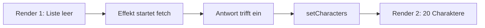

# Lab 5.1: Daten laden mit fetch – Rick and Morty API

**Leitfragen:**

<details>
<summary>Was passiert, wenn `fetch` direkt im Render steht?</summary>

Jeder Render startet eine neue Anfrage. Die Antwort ruft einen Setter auf, der Setter löst einen Render aus, und der startet die nächste Anfrage: eine Endlosschleife.

</details>

<details>
<summary>Wo sieht man, was die API wirklich zurückgibt?</summary>

Im Network-Tab der Browser-DevTools (Filter „Fetch/XHR“, Reiter „Response“ oder „Preview“). Die URL lässt sich auch direkt im Browser öffnen.

</details>

<details>
<summary>Warum ist die Liste beim ersten Render leer?</summary>

Der erste Render läuft vor dem Effekt und vor der Antwort. Der Anfangswert `[]` wird angezeigt, bis `setCharacters` einen zweiten Render mit Daten auslöst.

</details>

- Eine API liefert Daten über eine URL, meist als JSON; eine React-App lädt sie zur Laufzeit nach.
- `fetch` startet die Anfrage und gibt ein Promise zurück; `.then` wertet die Antwort aus.

## REST-API und JSON

Eine REST-API stellt Ressourcen unter URLs bereit; die HTTP-Methode sagt, was mit der Ressource passiert. Typische Daten: Benutzerinfos, Produkte, Posts, hier Charaktere.

| Methode | Zweck | Beispiel |
| ------- | ----- | -------- |
| `GET` | Daten lesen | `GET /api/character` |
| `POST` | Neuen Eintrag anlegen | `POST /api/notes` mit JSON-Body |
| `PUT` | Eintrag ersetzen | `PUT /api/notes/5` |
| `DELETE` | Eintrag löschen | `DELETE /api/notes/5` |

Die Rick-and-Morty-API ist öffentlich, braucht keinen Schlüssel und kennt nur `GET`:

```text
GET https://rickandmortyapi.com/api/character
```

```json
{
  "info": { "count": 826, "pages": 42, "next": "https://rickandmortyapi.com/api/character?page=2", "prev": null },
  "results": [
    { "id": 1, "name": "Rick Sanchez", "status": "Alive", "species": "Human", "image": "https://rickandmortyapi.com/api/character/avatar/1.jpeg" }
  ]
}
```

- `info` beschreibt die Seitenzahl, `results` enthält pro Seite 20 Charaktere.
- Die Antwort hat mehr Felder (`origin`, `location`, `episode`, …); die App liest nur, was sie anzeigt.

## Antwort im Network-Tab ansehen

1. DevTools öffnen (`F12`), Reiter **Network** wählen, Seite neu laden.
2. Filter **Fetch/XHR** setzen: Es bleiben nur API-Anfragen übrig.
3. Anfrage `character` anklicken: **Headers** zeigt URL, Methode und Status (`200`), **Response** den rohen JSON-Text, **Preview** einen Baum.

## Typ für die Antwort

`src/shared/character.ts` beschreibt die Felder, die der Kurs benutzt:

```ts
export const API_BASE_URL = "https://rickandmortyapi.com/api";

export type Character = {
  id: number;
  name: string;
  status: string;
  species: string;
  image: string;
};

export type CharacterPage = {
  info: { count: number; pages: number; next: string | null; prev: string | null };
  results: Character[];
};
```

TypeScript prüft die Form der Daten nur zur Entwicklungszeit; zur Laufzeit kann die API etwas anderes liefern.

## fetch mit .then

`fetch(url)` gibt sofort ein Promise zurück. `response.json()` liefert ein zweites Promise, daher zwei `.then`-Schritte.

```tsx
import { useEffect, useState } from "react";
import { API_BASE_URL, type Character, type CharacterPage } from "../../../shared/character";

const App = () => {
  // Beim ersten Render ist die Liste leer: Die Daten sind noch unterwegs.
  const [characters, setCharacters] = useState<Character[]>([]);

  useEffect(() => {
    fetch(`${API_BASE_URL}/character`)
      .then((response) => response.json())                     // Antwort-Text → JavaScript-Objekt
      .then((data: CharacterPage) => setCharacters(data.results)) // State setzen → zweiter Render
      .catch((error) => console.error("Anfrage fehlgeschlagen", error)); // nur Netzwerkfehler
  }, []);

  return (
    <main className="p-8">
      <p className="mb-4">{characters.length} Charaktere geladen</p>
      <div className="grid grid-cols-2 gap-4 md:grid-cols-4 lg:grid-cols-5">
        {characters.map((character) => (
          <div key={character.id}>
            
            <div>{character.name}</div>
          </div>
        ))}
      </div>
    </main>
  );
};

export default App;
```

Vollständige Datei: `src/examples/m05-api-fetching/l01-fetch-with-promises/index.tsx`.

| Teil | Aufgabe |
| ---- | ------- |
| `useState<Character[]>([])` | Startwert für den ersten Render, getypt als Liste von `Character` |
| `useEffect(..., [])` | startet die Anfrage einmal nach dem ersten Render |
| `.then` / `.catch` | wertet das Promise aus bzw. fängt Netzwerkfehler ab |
| `key={character.id}` | stabile Identität pro Listeneintrag |

## Warum der Aufruf in useEffect gehört

Eine Anfrage ist ein Seiteneffekt: Sie gehört nicht in den Render, sondern in einen Effekt oder Event-Handler.

| Ort des `fetch` | Ergebnis |
| --------------- | -------- |
| direkt im Render | Endlosschleife: Render → Anfrage → Setter → Render → … |
| in einem Event-Handler | Anfrage bei Klick (passt für „Laden“-Buttons) |
| in `useEffect(..., [])` | genau eine Anfrage nach dem ersten Render |
| in `useEffect(..., [id])` | neue Anfrage, sobald sich `id` ändert (siehe Lab 5.3) |

```tsx
// NICHT AUSFÜHREN: Anfrage im Render
const App = () => {
  const [characters, setCharacters] = useState<Character[]>([]);
  fetch(`${API_BASE_URL}/character`)
    .then((response) => response.json())
    .then((data: CharacterPage) => setCharacters(data.results)); // Setter → neuer Render → neue Anfrage
  return <p>{characters.length}</p>;
};
```

Ablauf mit Effekt:



Im Entwicklungsmodus startet `<StrictMode>` Effekte zweimal; der Network-Tab zeigt dann zwei Anfragen. Im Produktionsbuild läuft der Effekt einmal.

## Ausblick: fetch-Optionen

`fetch` akzeptiert als zweites Argument ein Objekt mit Optionen. Damit lassen sich Daten senden, nicht nur lesen.

| Option | Bedeutung | Beispiel |
| ------ | --------- | -------- |
| `method` | HTTP-Methode (Standard `GET`) | `"POST"` |
| `headers` | Zusatzinformationen zur Anfrage | `{ "Content-Type": "application/json" }` |
| `body` | gesendete Daten (als String) | `JSON.stringify({ title: "Hallo" })` |
| `mode` | CORS-Verhalten für Anfragen an fremde Domains | `"cors"` |

```ts
// Beispiel-Endpunkt eines Test-Dienstes; die Rick-and-Morty-API nimmt keine POST-Anfragen an.
fetch("https://jsonplaceholder.typicode.com/posts", {
  method: "POST",
  headers: { "Content-Type": "application/json" },
  body: JSON.stringify({ title: "Hallo", userId: 1 }),
})
  .then((response) => response.json())
  .then((created) => console.log("Angelegt:", created));
```

`fetch` löst das ältere `XMLHttpRequest` (XHR) ab; in älterem Code steht es noch.

> **Merksatz:** `fetch` gehört in `useEffect`, die Antwort in den State, und der erste Render zeigt immer den Startwert.

## Fazit

- `fetch` + `.then` lädt JSON; `useEffect(..., [])` startet die Anfrage genau einmal pro Mount.
- Der Network-Tab zeigt, was die API wirklich liefert; der Typ `Character` beschreibt nur den genutzten Ausschnitt.
- `method`, `headers` und `body` machen aus `fetch` auch einen Sender von Daten.

Die Übung baut die Charakter-Galerie mit 20 Karten.
