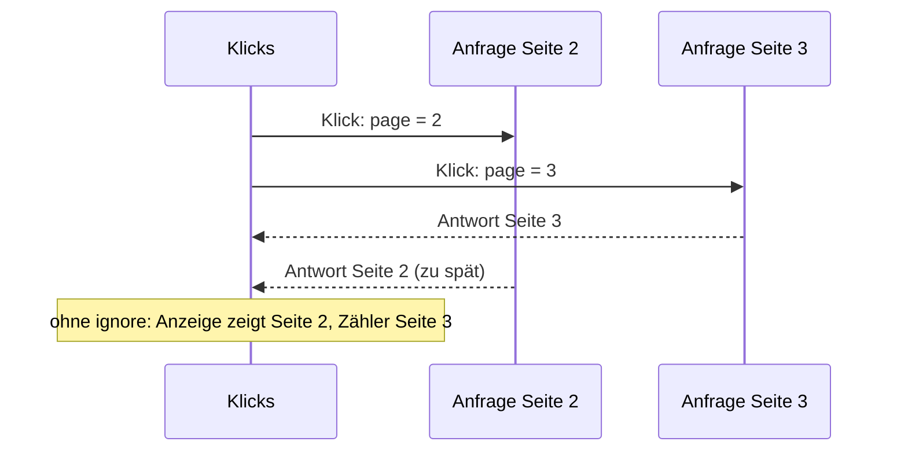

# Lab 5.3: axios und Pagination

**Leitfragen:**

<details>
<summary>Was nimmt axios gegenüber `fetch` ab?</summary>

JSON-Parsing (`response.data`), die Fehlerprüfung bei 404/500 (axios wirft), die Basis-URL, Query-Parameter über `params` und einen Timeout.

</details>

<details>
<summary>Warum reicht es, nur `page` zu ändern?</summary>

`page` steht im Dependency-Array des Effekts. Ändert sich der State, rendert die Komponente neu und der Effekt lädt die neue Seite.

</details>

<details>
<summary>Was passiert bei sehr schnellem Klicken?</summary>

Mehrere Anfragen laufen gleichzeitig; ihre Antworten können in anderer Reihenfolge eintreffen. Eine späte Antwort der alten Seite überschreibt dann die aktuelle (Race Condition). Ein Cleanup mit Flag schützt davor.

</details>

- axios kapselt `fetch`-Boilerplate in einer Instanz mit Basis-URL, Timeout und Standard-Headern.
- Paging heißt: `page` als State, `page` im Dependency-Array, `page` als Query-Parameter.

## fetch und axios im Vergleich

axios ist eine Bibliothek (`npm install axios`, im Kurs-Repo bereits installiert) und läuft im Browser und in Node.js.

| Aspekt | `fetch` | axios |
| ------ | ------- | ----- |
| Installation | im Browser eingebaut | `npm install axios` |
| JSON lesen | `await response.json()` | `response.data` ist schon geparst |
| HTTP-Fehler (404, 500) | kein Fehler, `response.ok` prüfen | wirft automatisch |
| Basis-URL | pro Aufruf zusammensetzen | `baseURL` in der Instanz |
| Query-Parameter | String selbst bauen | Option `params: { page }` |
| Timeout | nur über `AbortSignal` | Option `timeout` in Millisekunden |
| Body senden | `JSON.stringify` + Header | `axios.post(url, objekt)` serialisiert selbst |
| Typisierung | `response.json()` liefert `any` | `api.get<CharacterPage>(...)` |

## axios-Instanz

Eine Instanz legt gemeinsame Einstellungen an einer Stelle fest:

```ts
import axios from "axios";
import { API_BASE_URL, type CharacterPage } from "../../../shared/character";

const api = axios.create({
  baseURL: API_BASE_URL, // Aufrufe schreiben nur noch den Pfad: "/character"
  timeout: 10000,        // nach 10 s bricht axios mit einem Fehler ab
});

const response = await api.get<CharacterPage>("/character", { params: { page: 2 } });
// Anfrage: GET https://rickandmortyapi.com/api/character?page=2
console.log(response.data.results.length); // 20
```

Wichtige Optionen (auch pro Aufruf möglich):

| Option | Bedeutung |
| ------ | --------- |
| `baseURL` | gemeinsamer Anfang aller URLs |
| `timeout` | maximale Wartezeit in Millisekunden |
| `headers` | zusätzliche Header, z. B. `{ Authorization: "Bearer …" }` für geschützte APIs |
| `params` | Query-Parameter als Objekt |
| `method` / `data` | Methode und Body, wenn kein Kurzaufruf genutzt wird |

Kurzaufrufe: `api.get(url)`, `api.post(url, data)`, `api.put(url, data)`, `api.delete(url)`.

## Paging: page als State im Dependency-Array

Die Seitenzahl ist State; jeder Klick ändert sie, der Effekt reagiert darauf.

```tsx
const App = () => {
  const [characters, setCharacters] = useState<Character[]>([]);
  const [page, setPage] = useState(1);
  const [isLoading, setIsLoading] = useState(true);
  const [error, setError] = useState<string | null>(null);

  // Ändert sich page, läuft der Effekt erneut und lädt die neue Seite.
  useEffect(() => {
    // Schutz vor veralteten Antworten bei schnellem Klicken (Race Condition)
    let ignore = false;

    const loadCharacters = async () => {
      setIsLoading(true);
      setError(null);
      try {
        if (SLOW_DEMO) await new Promise((resolve) => setTimeout(resolve, 2000));
        const response = await api.get<CharacterPage>("/character", { params: { page } });
        if (!ignore) setCharacters(response.data.results);
      } catch (e) {
        if (!ignore) setError(e instanceof Error ? e.message : "Unbekannter Fehler");
      } finally {
        if (!ignore) setIsLoading(false);
      }
    };
    loadCharacters();

    return () => {
      ignore = true; // läuft vor dem nächsten Effekt und beim Entfernen der Komponente
    };
  }, [page]);

  return (
    <main className="p-8">
      <button onClick={() => setPage(page - 1)} disabled={page === 1}>Zurück</button>
      <span className="mx-4 font-semibold">Seite {page}</span>
      <button onClick={() => setPage(page + 1)}>Weiter</button>
      {isLoading && <p>Lade …</p>}
      {error && <p className="text-red-600">Fehler beim Laden: {error}</p>}
      {/* Grid: {!isLoading && characters.map(...)} */}
    </main>
  );
};
```

Vollständige Datei: `src/examples/m05-api-fetching/l03-axios-and-pagination/index.tsx`.

| Teil | Aufgabe |
| ---- | ------- |
| `[page]` | Effekt neu starten, sobald sich `page` ändert |
| `params: { page }` | hängt `?page=…` an die URL |
| `disabled={page === 1}` | „Zurück“ gibt es auf Seite 1 nicht |
| `SLOW_DEMO` | markierter Demo-Schalter: `true` simuliert 2 s Netzverzögerung |

Die API kennt 42 Seiten. Seite 43 antwortet mit 404; axios wirft, die Seite zeigt die Fehlermeldung. Die Erweiterung liest `info.pages` und deaktiviert „Weiter“ auf der letzten Seite.

## Race Condition bei schnellem Klicken

Jeder Klick startet eine Anfrage. Antwortet Seite 2 langsamer als Seite 3, überschreibt sie die Anzeige der Seite 3, obwohl `page` schon `3` ist.



Mit `ignore = true` im Cleanup verwirft der alte Durchlauf seine Antwort. Alternative: Anfrage per `AbortController` abbrechen. Das Problem zeigt sich mit `SLOW_DEMO = true` und drei schnellen Klicks auf „Weiter“: Ohne `ignore` erscheinen nacheinander die Inhalte der Seiten 2, 3 und 4 unter der Seitenzahl 4, und „Lade …“ verschwindet schon nach der ersten Antwort.

> **Merksatz:** Wer im Effekt lädt, braucht für jede Anfrage einen Cleanup, sonst gewinnt die letzte Antwort statt der letzten Eingabe.

## Erweiterung: Statusfilter

Die API filtert über `?status=alive` oder `?status=dead`. Ein zweiter State kommt in `params` und ins Dependency-Array; ein Filterwechsel setzt `page` auf `1` zurück. Referenz: `src/examples/m05-api-fetching/l03-axios-and-pagination/app-status-filter.tsx`.

## Fazit

- axios spart gegenüber `fetch` `.json()`, die `ok`-Prüfung und die URL-Bastelei; Instanz und `params` halten den Code kurz.
- `page` als State im Dependency-Array lädt automatisch nach; Buttons ändern nur den State.
- Schnelles Klicken erzeugt Race Conditions; ein Cleanup mit `ignore`-Flag löst sie.

Die Übung ergänzt „Zurück“, „Weiter“ und die Seitenzahl; die Erweiterung fügt den Statusfilter hinzu.
