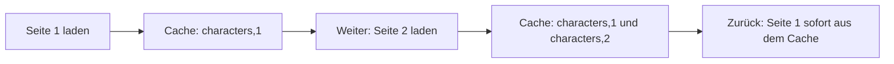

# Lab 6.1: useQuery – Laden ohne eigenen Effekt

**Leitfragen:**

<details>
<summary>Welche Zeilen aus Lab 5.3 fallen weg?</summary>

Die State-Variablen für Daten, `isLoading` und `error`, der Effekt mit `try/catch/finally` und das `ignore`-Flag. Übrig bleiben `page` und die Request-Funktion.

</details>

<details>
<summary>Warum lädt Seite 1 beim Zurückblättern sofort?</summary>

Der Cache hält die Antwort unter dem Schlüssel `["characters", 1]`. `useQuery` zeigt sie sofort an; solange sie als frisch gilt (`staleTime`), startet keine neue Anfrage.

</details>

<details>
<summary>Wann reicht `useEffect` trotzdem?</summary>

Für eine einzelne, einfache Anfrage ohne Cache und ohne Teilen der Daten, etwa in einer Mini-App. Auch für Effekte, die keine Server-Daten betreffen (Timer, Browser-APIs).

</details>

- Server-State gehört dem Server; eine Bibliothek verwaltet Laden, Fehler, Cache und Aktualisierung.
- `useQuery` ersetzt `useState` + `useEffect` + Fehlerlogik für Server-Daten durch einen Aufruf.

## Client-State und Server-State

| Merkmal | Client-State | Server-State |
| ------- | ------------ | ------------ |
| Besitzer | die App | der Server, die App hält nur eine Kopie |
| Beispiele | Eingabetext, Zähler, geöffnetes Menü | Charakterliste, Benutzerprofil |
| Veraltet? | nein | ja, die Kopie kann abweichen |
| Werkzeug | `useState`, Context | `useQuery` (TanStack Query) |
| Zusatzaufgaben | – | Laden, Fehler, Cache, erneutes Laden, Wiederholung |

Lab 5.3 hat all diese Zusatzaufgaben von Hand gelöst. TanStack Query übernimmt sie.

## Externe Hooks aus Bibliotheken

Bibliotheken bringen eigene Hooks mit. Sie werden wie ein Paket installiert und wie eigene Hooks aufgerufen.

| Schritt | Beispiel |
| ------- | -------- |
| Installieren (im Kurs-Repo bereits erledigt) | `npm install @tanstack/react-query` |
| Importieren | `import { useQuery } from "@tanstack/react-query";` |
| Aufrufen | `const { data } = useQuery({ … });` |
| Doku lesen | Installation und Setup stehen in der Doku der Bibliothek |

- Es gelten dieselben Regeln wie für eingebaute Hooks: nur auf oberster Ebene einer Komponente oder eines Hooks aufrufen.
- Weitere Beispiele des Kurses: `useParams` und `useSearchParams` (React Router, Modul 7), `useForm` (React Hook Form, Modul 9).

## QueryClientProvider und useQuery

Der `QueryClient` hält den Cache. Der `QueryClientProvider` stellt ihn allen Komponenten darunter bereit; er gehört einmal an die Wurzel.

```tsx
import { useState } from "react";
import { QueryClient, QueryClientProvider, useQuery } from "@tanstack/react-query";
import axios from "axios";
import { API_BASE_URL, type CharacterPage } from "../../../shared/character";

const api = axios.create({ baseURL: API_BASE_URL, timeout: 10000 });

// Die Query-Funktion enthält nur den Request; Laden, Fehler und Cache übernimmt useQuery.
const fetchCharacters = async (page: number): Promise<CharacterPage> => {
  const response = await api.get<CharacterPage>("/character", { params: { page } });
  return response.data;
};

const Gallery = () => {
  const [page, setPage] = useState(1);

  const { data, isPending, isLoading, isFetching, error } = useQuery({
    queryKey: ["characters", page],   // Cache-Schlüssel: pro Seite ein Eintrag
    queryFn: () => fetchCharacters(page),
    staleTime: 60_000,                // eine Minute lang frisch: kein erneuter Request
  });

  return (
    <main className="p-8">
      {/* Buttons wie in Lab 5.3 */}
      {isPending && <p>Lade …</p>}
      {error && <p className="text-red-600">Fehler beim Laden: {error.message}</p>}
      <div className="grid grid-cols-2 gap-4 md:grid-cols-4 lg:grid-cols-5">
        {data?.results.map((character) => (
          <div key={character.id}>
            
            <div>{character.name}</div>
          </div>
        ))}
      </div>
    </main>
  );
};

// Der Client hält den Cache; der Provider macht ihn für alle Komponenten darunter verfügbar.
const queryClient = new QueryClient();

const App = () => (
  <QueryClientProvider client={queryClient}>
    <Gallery />
  </QueryClientProvider>
);

export default App;
```

Vollständige Datei: `src/examples/m06-tanstack-query/l01-usequery-basics/index.tsx`.

| Option / Ergebnis | Bedeutung |
| ----------------- | --------- |
| `queryKey` | Array als Cache-Schlüssel; als Abhängigkeitsliste zu lesen: ändert sich `page`, lädt `useQuery` neu |
| `queryFn` | liefert ein Promise mit den Daten; wirft sie, wird daraus `error` |
| `data` | die geladenen Daten, bis zum ersten Ergebnis `undefined` |
| `error` | das Fehlerobjekt oder `null` |

`queryClient` steht außerhalb der Komponente. Würde er im Render neu erzeugt, ginge der Cache bei jedem Render verloren.

## isPending, isLoading und isFetching

| Wert | `true`, wenn … | Typische Nutzung |
| ---- | -------------- | ---------------- |
| `isPending` | für diesen Schlüssel noch keine Daten vorliegen | „Lade …“ anzeigen, bevor `data` benutzt wird |
| `isLoading` | `isPending` und gerade eine Anfrage läuft (erstes Laden) | Spinner für das erste Laden |
| `isFetching` | irgendeine Anfrage läuft, auch im Hintergrund | kleine „Aktualisiere …“-Anzeige |

Die Beispiel-App zeigt alle drei an. Beim ersten Laden einer Seite sind `isPending` und `isLoading` `true`; bei einer schon besuchten Seite sind sie `false`, und nur ein Hintergrund-Refetch würde `isFetching` setzen. `isPending` ist der sichere Prüfwert vor dem Zugriff auf `data`; `isLoading` stammt aus älteren Versionen (v4: `isLoading` bedeutete „noch keine Daten“).

## Cache beim Zurückblättern



| `staleTime` | Verhalten beim Zurückblättern | Network-Tab |
| ----------- | ----------------------------- | ----------- |
| `0` (Standard) | Seite 1 erscheint sofort, ein Hintergrund-Refetch prüft auf Neues | neue Anfrage sichtbar, Anzeige trotzdem ohne Wartezeit |
| `60_000` | Seite 1 erscheint sofort, keine Anfrage | keine neue Anfrage |

Weitere Standardwerte: bei Fehlern wiederholt `useQuery` die Anfrage dreimal mit wachsendem Abstand, ein Fehler erscheint daher erst nach einigen Sekunden; beim Zurückkehren in das Browserfenster lädt es veraltete Daten neu (`refetchOnWindowFocus`).

## Vergleich mit Lab 5.3

| Aspekt | Lab 5.3 (axios + `useEffect`) | Lab 6.1 (`useQuery`) |
| ------ | ----------------------------- | -------------------- |
| State-Variablen für Laden | `characters`, `isLoading`, `error` | keine |
| Datenabruf-Logik | rund 22 Zeilen: 3 State-Variablen, Effekt mit `try/catch/finally`, `ignore`-Flag | rund 9 Zeilen: Request-Funktion und `useQuery`-Aufruf |
| Cache beim Zurückblättern | keiner, jede Seite lädt neu | automatisch |
| Race Condition | selbst per `ignore` lösen | gelöst: Ergebnis gehört zum Schlüssel |
| Wiederholung bei Fehlern | selbst bauen | eingebaut (3 Versuche) |
| Zusatzkosten | – | Paket und `QueryClientProvider` |

## Wann useEffect trotzdem reicht

| Situation | Passende Wahl |
| --------- | ------------- |
| mehrere Komponenten brauchen dieselben Daten, Daten wiederholt sichtbar | `useQuery` |
| Seitenwechsel, Filter, Detailseiten mit Cache | `useQuery` |
| eine einmalige Anfrage in einer kleinen App | `useEffect` genügt |
| Timer, Event-Listener, Browser-APIs (keine Server-Daten) | `useEffect` |
| neue Produkt-Apps mit vielen Daten | Datenbibliothek oder Framework (react.dev empfiehlt für neue Apps ein Framework) |

> **Merksatz:** Server-Daten gehören in `useQuery`, Zustand der Oberfläche in `useState`.

## Fazit

- Client-State gehört der App, Server-State dem Server; für Letzteren übernimmt TanStack Query Laden, Fehler, Cache und Wiederholung.
- `QueryClientProvider` einmal an der Wurzel, `useQuery` mit `queryKey: ["characters", page]` und `queryFn` in der Komponente.
- `isPending` prüft „noch keine Daten“, `isLoading` „erstes Laden läuft“, `isFetching` „irgendeine Anfrage läuft“.

Die Übung baut die axios-Galerie aus Lab 5.3 auf `useQuery` um.
