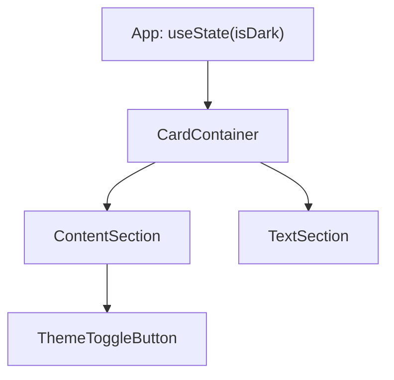

# Lab 8.1: Theme-App: Props durchreichen

**Leitfragen:**

<details>
<summary>Welche Komponenten brauchen `isDark` wirklich?</summary>

`CardContainer` (Hintergrundfarbe), `TextSection` (Textfarbe) und `ThemeToggleButton` (Beschriftung und Umschalten). `ContentSection` liest den Wert nicht, sie gibt ihn nur weiter.

</details>

<details>
<summary>Was ändert sich, wenn ein Button tiefer verschachtelt wird?</summary>

Jede Zwischenkomponente bekommt zwei weitere Props, und alle Aufrufer ändern sich mit. Der Aufwand wächst mit jeder Ebene.

</details>

<details>
<summary>Wo sollte der Theme-State leben?</summary>

In der obersten Komponente, die alle Verbraucher umschließt (hier `App`). Bei vielen Verbrauchern oder tiefen Bäumen löst Context (Lab 8.2) das Durchreichen ab.

</details>

- Ein State, den mehrere Komponenten brauchen, liegt im gemeinsamen Elternteil und wird per Props nach unten gegeben.
- Props, die eine Komponente nur an ihr Kind weiterreicht, heißen Prop Drilling.

## Die Theme-App ohne Context

Ein Dark Mode benötigt zwei Werte: `isDark` zum Lesen und `setDark` zum Umschalten. Der Button sitzt drei Ebenen unter dem State.



Referenz-App: `src/examples/m08-context-and-custom-hooks/l01-prop-drilling/index.tsx` (Dateien daneben).

```tsx
// App.tsx: Der State liegt oben und wird zweimal weitergegeben.
const App = () => {
  const [isDark, setDark] = useState(false);
  return (
    <main className="p-8">
      <CardContainer isDark={isDark} setDark={setDark}>
        <h1 className="text-3xl font-bold">Theme App</h1>
        <TextSection isDark={isDark} />
      </CardContainer>
    </main>
  );
};
```

```tsx
// CardContainer.tsx (Ebene 1): nutzt isDark für Farben, reicht setDark nur weiter.
const CardContainer = ({ isDark, setDark, children }: Props) => (
  <div className={isDark ? "bg-slate-800 text-white" : "bg-slate-300 text-black"}>
    <ContentSection isDark={isDark} setDark={setDark}>
      {children}
    </ContentSection>
  </div>
);

// ContentSection.tsx (Ebene 2): reiner Durchreicher, liest beide Props nie.
const ContentSection = ({ isDark, setDark, children }: Props) => (
  <section>
    {children}
    <ThemeToggleButton isDark={isDark} setDark={setDark} />
  </section>
);

// ThemeToggleButton.tsx (Ebene 3): braucht beide Props wirklich.
const ThemeToggleButton = ({ isDark, setDark }: Props) => (
  <button onClick={() => setDark(!isDark)}>{isDark ? "Licht an" : "Licht aus"}</button>
);
```

## Wer braucht was?

| Komponente | liest `isDark` | nutzt `setDark` | Rolle |
| --- | --- | --- | --- |
| `App` | nein | nein | besitzt den State |
| `CardContainer` | ja (Farben) | nein | Verbraucher und Durchreicher |
| `ContentSection` | nein | nein | reiner Durchreicher |
| `ThemeToggleButton` | ja (Text) | ja | Verbraucher |
| `TextSection` | ja (Farbe) | nein | Verbraucher |

## Symptome von Prop Drilling

| Symptom | Folge |
| --- | --- |
| Props in Signaturen, die die Komponente selbst nicht nutzt | Komponenten sind schwer wiederzuverwenden |
| Neue Verschachtelungsebene | Props und Typen in jeder Zwischenkomponente ergänzen |
| Neuer Verbraucher tief im Baum | Kette von der Wurzel bis dorthin anpassen |
| Umbenennung eines Props | Änderung in allen Dateien der Kette |

## Lokaler und globaler Zustand

| | Lokaler Zustand | Globaler Zustand |
| --- | --- | --- |
| Besitzer | eine Komponente (`useState`) | zentrale Stelle für viele Komponenten |
| Weitergabe | Props an direkte Kinder | ohne Durchreichen an beliebige Tiefe |
| Beispiel | Eingabefeld, Zähler | Theme, angemeldete Person, Sprache |
| Werkzeug im Kurs | `useState` (Tag 1) | Context (Lab 8.2) |

> **Merksatz:** Der State gehört in die niedrigste Komponente, die alle Verbraucher überdeckt; ab drei Ebenen Durchreichen lohnt sich ein anderer Weg.

## Fazit

- Props reichen für flache Bäume; tiefe Bäume erzeugen Durchreicher-Komponenten.
- Durchreicher erkennt man an Props, die die Komponente nie selbst liest.
- Der Aufwand steigt mit jeder Ebene und mit jedem neuen Verbraucher.

In der Übung entsteht die Theme-App mit Props, und die Durchreicher werden gezählt.
